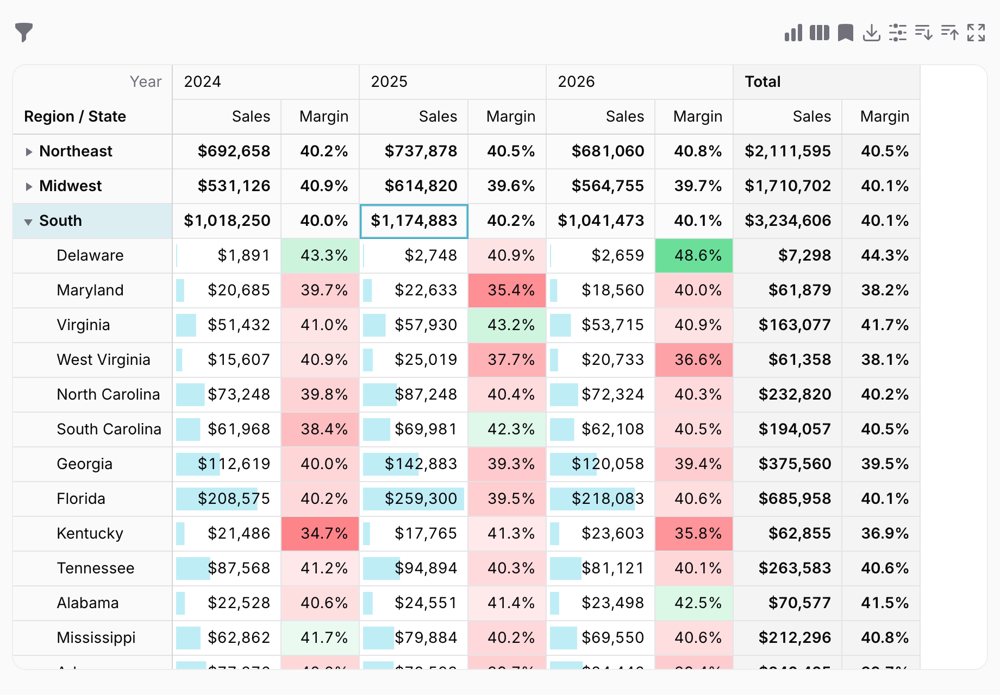
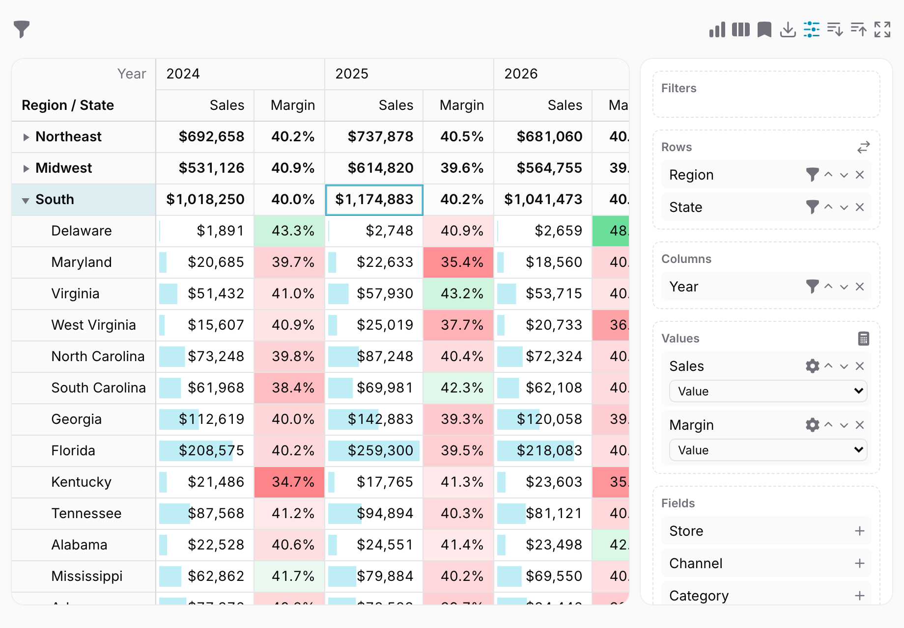
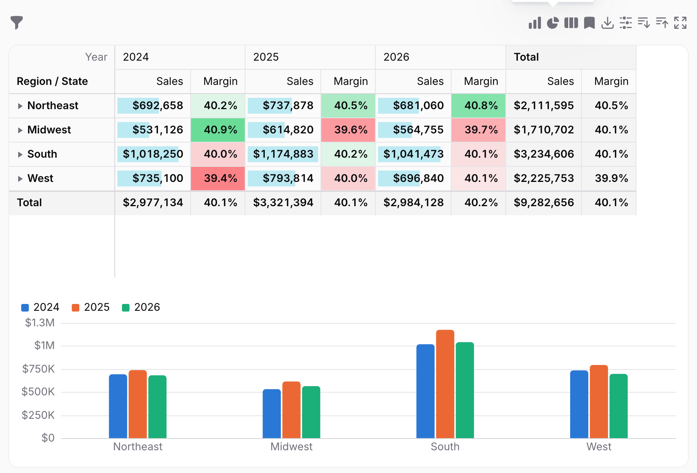
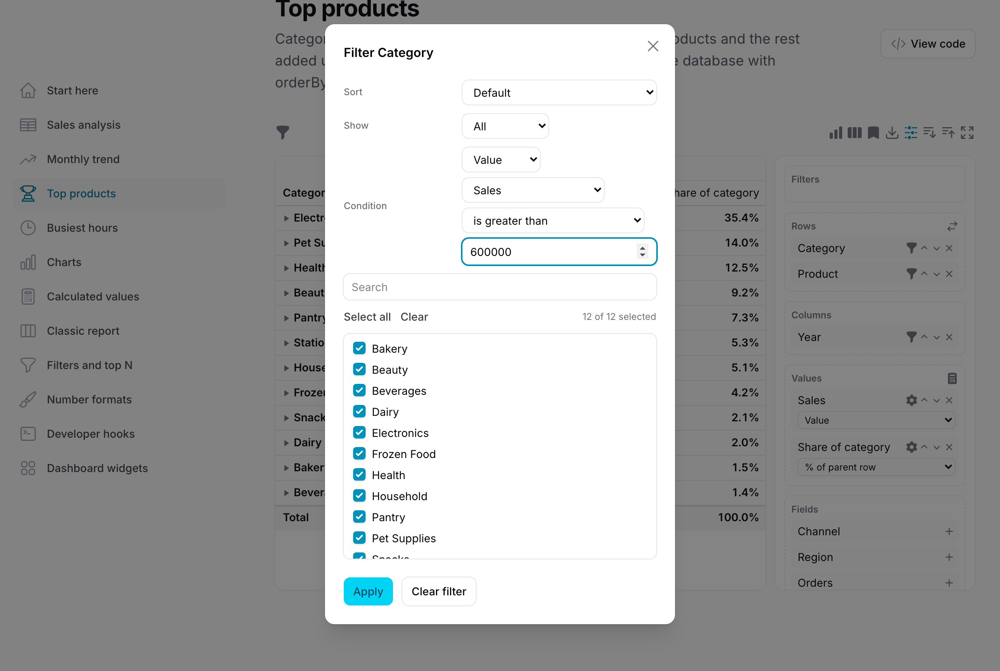
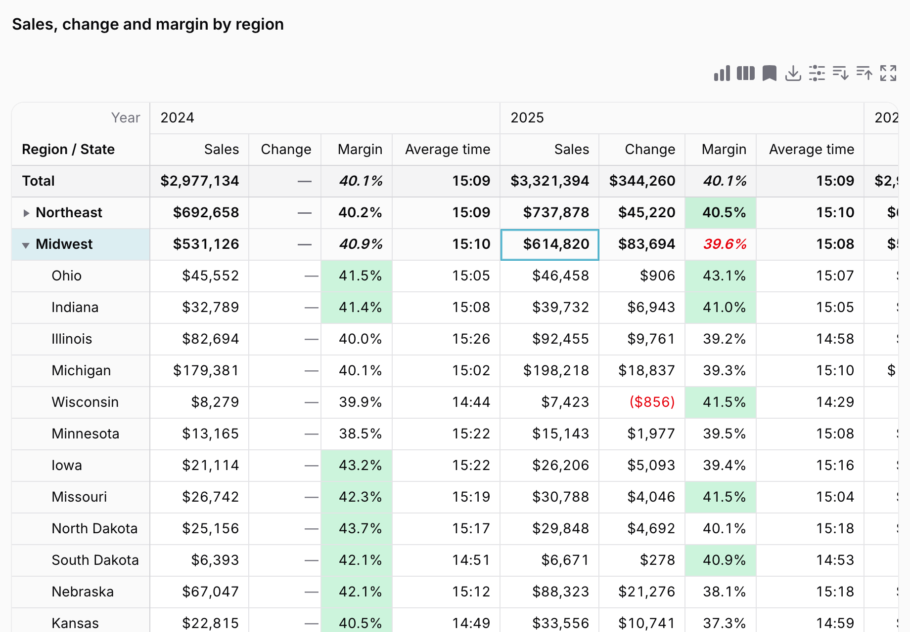
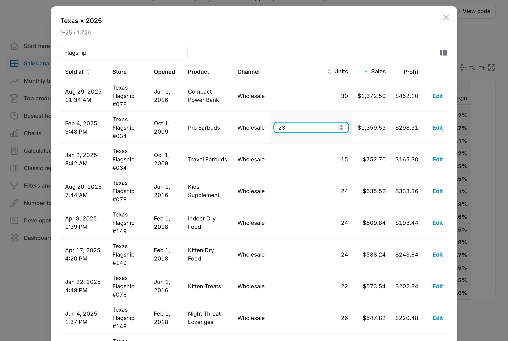

# Warp Pivot



**A pivot table for Filament that aggregates in the database and draws the result on a `<canvas>`: a million source rows are no heavier than a hundred, and a result of thousands of rows and hundreds of columns still scrolls smoothly. Filters, actions, policies and tenancy are Filament's own.**

<a href="https://demo.warpui.com/pivot"></a>

Drag fields across 200,000 sales, filter regions by their sales, open a cell to search and edit the sales behind it, and export the result to Excel or PDF at **[demo.warpui.com/pivot](https://demo.warpui.com/pivot)**. No sign-up needed; the data is reset every hour.

Pivot components for the browser load every record into JavaScript and add them up there. That stops working long before a sales table reaches a million rows. Warp Pivot sends `GROUP BY` queries to your database instead, only for the headers that are open, and sends only the totals to the browser.

```php
use Qalainau\FilamentWarpPivot\Dimensions\Date;
use Qalainau\FilamentWarpPivot\Dimensions\Relationship;
use Qalainau\FilamentWarpPivot\Measures\Ratio;
use Qalainau\FilamentWarpPivot\Measures\Sum;
use Qalainau\FilamentWarpPivot\Pages\PivotPage;
use Qalainau\FilamentWarpPivot\Pivot;

class SalesPivot extends PivotPage
{
    public function pivot(Pivot $pivot): Pivot
    {
        return $pivot
            ->query(Sale::class)
            ->rows([
                Relationship::make('store.state.region')->label('Region'),
                Relationship::make('store.state')->label('State'),
            ])
            ->columns([Date::make('sold_at')->year()->label('Year')])
            ->values([
                Sum::make('amount')->label('Sales')->money('USD'),
                Ratio::make('margin')->of(Sum::make('profit')->expression('amount - cost'), Sum::make('amount'))->percent(),
            ]);
    }
}
```

## Why

Measured on the demo app with 1,000,000 sales rows, 300 stores in three levels of regions and 5,000 products (MySQL 8.4 on a laptop, Chrome):

| | |
| --- | --- |
| First table on screen (regions × years) | about 1.2 s |
| Opening a region (one more query) | about 1.3 s |
| Opening every level at once | about 1.2 s |
| Drawing a frame of a 2,000 × 500 cell result while scrolling | about 1 ms |

Whatever is open, the source table is scanned once: the headers under closed headers are folded with `CASE` in the same query, and subtotals and grand totals are added up from that one result.

## Features



- **Database aggregation**: count, distinct count, sum, average, minimum, maximum, median, product, standard deviation, variance, ratios of two measures and SQL expressions. Averages, deviations and ratios of subtotals are computed from the records, never as averages of averages.
- **Calculated values**: formulas over other values (`[profit_sum] / [quantity_sum]`) or over the columns of each record before they are added up (`[amount] - [cost]`), defined in code or written by users in the field panel, with `abs`, `round`, `sqrt`, `min`, `max`, `if`, `and`, `or` and `not`.


- **Pivot charts**: switch the same result to column, stacked column, bar, stacked bar, line, area, column-and-line, pie, donut or scatter charts, or show the table and the chart together, with tooltips, a legend to hide series, a click to list the records, and PNG export.
- **Dimensions**: columns (enum casts give the labels and order), `belongsTo` relationships of any depth (`store.state.region`), dates by year, quarter, month, week, day or hour or by month of year, weekday and hour of day in the user's timezone (daylight saving included), numeric bins and SQL expressions.
- **Open what you need**: headers open on demand and only the opened part is queried. Expand or collapse everything or one level, sort rows by any column, keep the top or bottom N per group with the rest as "Other", and cap the number of cells.


- **Filter by members and conditions**: pick the values of any dimension from a searchable checklist, or keep what matches a condition on the label (contains, begins with, between…), on a value (sales over 1,000,000) or on the date (between two days, last month, this quarter), on the rows, the columns or a separate filters area. Sort headers A to Z, Z to A, by value or in your own order.
- **Show values as**: percentage of the row, column or grand total or of the parent row or column, difference or percentage difference from the previous column, running totals, index and rank.
- **Users arrange it**: a field panel to drag dimensions into rows, columns and filters and measures into values, change the aggregation of a value, save named layouts (private or shared, with a default per user, filters included) and share a link with the layout in the URL.
- **Layouts**: compact, classic (one column per row dimension, subtotals below) or flat tables, values side by side in columns or one under the other in rows (drag "Σ Values" like in Excel), with grand totals and subtotals shown or hidden per axis, the grand total at the top or the bottom, a title, and columns resized by dragging.


- **Formats and colors**: decimals, prefixes and suffixes, currencies (also amounts stored in cents), percentages and durations, negative numbers in parentheses, your own separators, and text for empty cells and divisions by zero; heatmaps, data bars and conditional formatting by thresholds or formulas (`[value] < 0 and [amount_sum] > 1000000`) with colors, bold and italic, for all cells, values only or totals only, set in code or by users.
- **Drill down**: double-click a cell, or press Enter, to list the records behind it. Search and sort them, choose the columns, edit a cell in place or run Filament actions such as edit and delete without leaving the list: the totals update when you save. Link to each record and to another screen for the same records.
- **Export and print**: Excel (.xlsx) with merged headers, frozen labels and number formats, CSV, PDF, PNG of the table or the chart, HTML, and printing with the headers repeated on every page, all with a header and footer (title, date, page numbers). Hand files to the server instead of downloading them, and save or open a layout as a file. Full-screen mode.
- **Context menus**: right-click a header to expand or collapse its level, sort or filter it, or a cell to list its records, copy it, change how its value is shown or run your own Filament actions.
- **Hooks for developers**: Filament actions on cells with the records of the cell, a JavaScript API (state, layout, filters, cells, chart data for other chart libraries), events for clicks, data and changes, and hooks to draw cells and build the context menu your way.
- **Browser tests**: `cellPoint()` tells a Playwright test where a cell is on the canvas and what it shows, `rowHeaderRect()` and `fieldRect()` where a row header and a field of the field panel are, and `whenIdle()` waits until the totals, the drill-down or a save have finished.
- **Filament inside**: Filament table filters, policies (`viewAny`, `update`, `delete`), tenancy, actions, notifications, dark mode and translations (English, Japanese, German, French, Spanish, Italian, Brazilian Portuguese, Korean and Chinese, simplified and traditional).
- **Keyboard and screen readers**: arrow keys, Shift to extend a selection, Ctrl/Cmd+A and Ctrl/Cmd+C (tab-separated, ready to paste into a spreadsheet), and a live count, sum and average of the selection. The visible cells are exposed as an ARIA grid.

## Requirements

- PHP 8.3+
- Laravel 12 or 13
- Filament 5.x (Livewire 4)
- MySQL 8 / MariaDB 10.6+, PostgreSQL 14+ or SQLite

## Installation

> **Warp Pivot is a commercial plugin.** A license is required. After purchase you receive credentials for the private Composer repository.

Add the repository and authenticate:

```bash
composer config repositories.qalainau composer https://qalainau.privato.pub/composer
composer config --auth http-basic.qalainau.privato.pub "your-email" "your-license-key"
```

Install the package, run the migrations and publish Filament's assets:

```bash
composer require qalainau/filament-warp-pivot
php artisan migrate
php artisan filament:assets
```

The migration creates one table, `warp_pivot_views`, for the layouts users save. Your tables are not changed. To edit the migration, publish it with `php artisan vendor:publish --tag=filament-warp-pivot-migrations`. Publish it before you run `php artisan migrate` for the first time: Warp Pivot then runs your copy instead of its own. If the tables already exist, change them with a migration of your own instead.

> Run `php artisan filament:assets` again after every update of the package.

### AI coding assistants (Laravel Boost)

Warp Pivot ships instructions for AI coding assistants such as Claude Code, Cursor and Codex. If your app uses
[Laravel Boost](https://laravel.com/docs/boost), the assistant learns how to use Warp Pivot from them: which classes to extend, how to compute ratios and margins that stay right in subtotals, what is easy to get wrong, and how to test a pivot.

- **Guidelines** (`resources/boost/guidelines/core.md`): a short summary that Boost adds to `CLAUDE.md`,
  `AGENTS.md` and the other agent files. It also points the assistant to this README in `vendor/`, so it reads the
  documentation of the version you have installed instead of guessing.
- **Skill** `warp-pivot-development` (`resources/boost/skills/`): the steps for adding a pivot, values that stay right in subtotals (margins, unit prices, money in cents), access, drill-down, and writing feature and browser tests. The assistant loads it when it works on a pivot.

Boost does not add guidelines of other vendors' packages on its own. When `php artisan boost:install` asks
"Which third-party AI guidelines/skills would you like to install?", select `qalainau/filament-warp-pivot`. To do
it without the question, add the package to `boost.json` and run the command again:

```json
{
    "packages": ["qalainau/filament-warp-pivot"]
}
```

```bash
php artisan boost:install --guidelines --skills -n
```

After you update Warp Pivot, run `php artisan boost:update` so the assistant gets the instructions of the new
version.

## Usage

### Where to put a pivot

Extend `PivotPage` for a full page or `PivotWidget` for a dashboard widget, and implement `pivot()`.

A widget can read the dashboard's filters with Filament's `InteractsWithPageFilters`. Use `$this->pageFilters` in the query, and the pivot is queried again whenever they change:

```php
use Filament\Widgets\Concerns\InteractsWithPageFilters;

class SalesByRegion extends PivotWidget
{
    use InteractsWithPageFilters;

    public function pivot(Pivot $pivot): Pivot
    {
        return $pivot->query(fn (): Builder => Sale::query()
            ->when($this->pageFilters['channel'] ?? null, fn (Builder $query, string $channel) => $query->where('channel', $channel)));
    }
}
```

In any other Livewire component, implement `HasPivot`, `HasSchemas` and `HasActions`, use `InteractsWithPivot`, `InteractsWithSchemas` and `InteractsWithActions`, and render `{{ $this->getWarpPivot() }}`. The pivot's properties and methods are prefixed with `warpPivot`. `HasPivot` includes Filament's `HasTable`: the pivot uses a hidden table for its filters, so the component cannot have a Filament table of its own.

### Records

`query()` takes a model class, an Eloquent query or a closure returning one. Global scopes such as soft deletes apply.

```php
$pivot->query(fn (): Builder => Sale::query()->where('status', 'paid'));
```

### Dimensions

Put dimensions in `rows()` and `columns()`, outermost first. `dimensions()` registers more that users can add from the field panel.

```php
use Qalainau\FilamentWarpPivot\Dimensions\Bins;
use Qalainau\FilamentWarpPivot\Dimensions\Column;
use Qalainau\FilamentWarpPivot\Dimensions\Date;
use Qalainau\FilamentWarpPivot\Dimensions\Expression;
use Qalainau\FilamentWarpPivot\Dimensions\Relationship;

Column::make('channel');                                     // enum casts give labels and order
Column::make('status')->options(['open' => 'Open', 'closed' => 'Closed']);
Relationship::make('product.category')->titleAttribute('name')->orderBy('sort');
Date::make('sold_at')->month();                              // year, quarter, week, day, hour
Date::make('sold_at')->dayOfWeek()->weekStartsOn(0);         // monthOfYear, quarterOfYear, hourOfDay
Date::make('sold_at')->month()->timezone('Europe/Berlin');   // defaults to FilamentTimezone
Bins::make('amount')->width(1000);                           // 0 – 1,000, 1,000 – 2,000, …
Bins::make('amount')->ranges([1000, 5000, 20000]);           // under 1,000 … 20,000 and over
Expression::make('size')->sql("case when amount >= 5000 then 'large' else 'small' end");
```

Every dimension accepts `label()`, `formatLabelUsing(fn (string $value, string $label): string => …)`, `orderByValue()` (largest total first) and `limit(10)` (the ten largest per group, the rest as "Other").

`rows()` and `columns()` take the dimension itself, or the name of one registered with `dimensions()`. A name that was not registered stops the pivot with `The pivot has no dimension named [store].`

```php
$pivot
    ->dimensions([Relationship::make('store'), Date::make('ordered_at')->year(), Date::make('ordered_at')->month()])
    ->rows(['store'])
    ->columns(['ordered_at:month']);
```

Names of dimensions:

- Most dimensions are named after what you pass to `make()`: `channel`, `store`, `store.region`.
- A `Date` dimension is always named `column:granularity`, even when it is the only one on that column: `ordered_at:month`, `ordered_at:year`. `ordered_at` alone is not a name. The granularities are `year`, `quarter`, `month`, `week`, `day`, `hour`, `month_of_year`, `quarter_of_year`, `day_of_week` and `hour_of_day` (so `dayOfWeek()` is `ordered_at:day_of_week`).
- Use the same name wherever a dimension is named: in `rows()` and `columns()`, in the `$conditions` of `drillDownUrl()` and of cell actions (`['ordered_at:month' => …]`), in the layout that `warpPivotFetch()` takes, and in tests (`$data['dimensions']['rows'][0]['name']` is `ordered_at:month`).

Relationships are grouped by their foreign key, and their labels are read afterwards, so a `belongsTo` with a million rows behind it costs nothing extra. Only the relationships in the middle of a path are joined.

Dates and time zones: the pivot reads the stored dates in `config('app.timezone')`, the timezone Laravel saves them in, and groups them by the clock of the dimension's timezone: `timezone()`, else Filament's `FilamentTimezone`, else `app.timezone`. For dates stored in UTC and a report in Tokyo time, keep `app.timezone` at `UTC` and call `->timezone('Asia/Tokyo')` (or `FilamentTimezone::set('Asia/Tokyo')` for every date of the panel). A sale stored as `2026-03-31 15:30:00` is then in April (00:30 on 1 April in Tokyo). Setting `app.timezone` to `Asia/Tokyo` instead would make the pivot read the stored UTC times as Tokyo times.

### Measures

```php
use Qalainau\FilamentWarpPivot\Enums\ShowAs;
use Qalainau\FilamentWarpPivot\Measures\Avg;
use Qalainau\FilamentWarpPivot\Measures\Count;
use Qalainau\FilamentWarpPivot\Measures\CountDistinct;
use Qalainau\FilamentWarpPivot\Measures\Max;
use Qalainau\FilamentWarpPivot\Measures\Median;
use Qalainau\FilamentWarpPivot\Measures\Min;
use Qalainau\FilamentWarpPivot\Measures\Product;
use Qalainau\FilamentWarpPivot\Measures\Ratio;
use Qalainau\FilamentWarpPivot\Measures\StdDev;
use Qalainau\FilamentWarpPivot\Measures\Sum;
use Qalainau\FilamentWarpPivot\Measures\Variance;

Count::make();
CountDistinct::make('customer_id');
Sum::make('amount')->money('USD');
Avg::make('amount')->decimals(0)->suffix(' avg');
Sum::make('profit')->expression('amount - cost');
Ratio::make('margin')->of(Sum::make('profit')->expression('amount - cost'), Sum::make('amount'))->percent();
Sum::make('amount')->name('share')->showAs(ShowAs::PercentOfColumnTotal);
Sum::make('amount')->name('growth')->showAs(ShowAs::PercentDifferenceFromPrevious);
StdDev::make('amount');                                      // sample; ->population() for the population
Variance::make('amount');
Sum::make('amount')->name('index')->showAs(ShowAs::Index);
Sum::make('amount')->name('rank')->showAs(ShowAs::Rank, along: 'rows');
Median::make('amount');                                      // queried per level, like distinct counts
Product::make('growth_factor');
Avg::make('handling_seconds')->duration('seconds');          // 27:05:00, or ->duration('minutes', 'short') for 27h 5m
Sum::make('balance')->negativeInParentheses()->blankAs('—')->divisionByZeroAs('#DIV/0!')->separators(' ', ',');
```

A measure's name defaults to `column_function` (`amount_sum`); set another with `name()`, for example when the same column appears twice. Users can change how each value is shown in the field panel.

Two different measures with the same name in one `values()` or `measures()` call stop the pivot with `The pivot has two measures named [amount_sum]`, because the second one would replace the first (the Sales column would disappear behind a share of sales). Give the second one its own `name()`. A later call may pass a measure of the same name again and replaces the earlier one, as when a page changes the values of the page it extends.

#### Money stored in cents

If you store amounts as whole cents (an `integer` column, `4499` for $44.99), pass `divideBy`, like Filament's `TextColumn::money()`:

```php
$pivot->values([
    Sum::make('line_total')->label('Sales')->money('USD', divideBy: 100),
    Avg::make('line_total')->label('Average order')->money('USD', divideBy: 100),
    Formula::make('unit_price')->formula('[line_total_sum] / [quantity_sum]')->money('USD'),
]);
```

- The database adds up the cents as integers, and each cell is divided once, after it is added up. A cell is then exactly 44.99, never 44.9999998, on screen, in the Excel cell and in the CSV. Dividing in the query instead (`->expression('line_total / 100.0')`) adds up decimals and leaves those tails.
- Everything after the totals sees the divided value: formulas (`[line_total_sum]` above is in dollars), ratios, "Show values as", conditional formatting and value conditions in filters (a user who keeps the stores with sales over 5,000 types dollars).
- So divide every amount that a formula or ratio combines in the same way. With `Sum::make('line_total')->money('USD', divideBy: 100)` and a plain `Sum::make('cost')`, the margin `([line_total_sum] - [cost_sum]) / [line_total_sum]` subtracts cents from dollars. Register the cost as `Sum::make('cost')->divideBy(100)` (in `measures()` if it is not shown), or divide it in the formula (`[cost_sum] / 100`).
- Counts are never divided, also when a user switches a value to a count in the field panel. Standard deviations are divided by `divideBy`, variances by its square and products by its power, so they stay in the unit of the money.
- `divideBy()` alone divides without a currency (`Sum::make('duration_ms')->divideBy(1000)->suffix(' s')`). It refuses 0.
- In Excel, an amount with a currency gets the decimals of that currency (two for USD and EUR, none for JPY) unless you set `decimals()`, like on screen.
- The drill-down lists the records themselves, still in cents: format those columns with `DrillDownFormat::money('USD', divideBy: 100)` (see [Dates and formats in the drill-down](#dates-and-formats-in-the-drill-down)).

Color cells with `heatmap('success', 'danger')` (high and low colors), `dataBars()` and `colorWhen('<', 0, 'danger')` (add `background: true` to fill the cell instead of coloring the text). Colors are Filament color names. Heatmaps and data bars are scaled to the innermost visible cells (closed groups included), without subtotals and totals.

`formatWhen()` takes a condition written like a calculated value, where `[value]` is the cell and `[name]` another value of the same cell, and sets a color, bold or italic, for all cells, the values only (`scope: 'cells'`) or the subtotals and totals only (`scope: 'totals'`):

```php
Ratio::make('margin')->of(/* … */)
    ->formatWhen('[value] < 0.3 and [amount_sum] > 1000000', 'danger', bold: true)
    ->formatWhen('[value] >= 0.5', 'success', background: true, scope: 'cells')
    ->formatWhen('[value] > 0', italic: true, scope: 'totals');
```

Users can change the aggregation of a value in the field panel (sum, average, minimum, maximum, count, standard deviation, variance, median or product of the same column) and its decimals, negative numbers, text for empty cells, heatmap, data bars and conditional formatting (thresholds or formulas, with colors, bold and italic). Limit the aggregations with `aggregations(['sum', 'avg'])`, or turn switching off with `aggregations(false)`. `aggregationLabels()` on the pivot names the values after their aggregation ("Sum of Sales").

### Calculated values

A `Formula` computes a value from other measures of the pivot, by name (or label) in brackets. Each measure is aggregated first and the formula is applied to the results of every cell, so subtotals are right.

```php
use Qalainau\FilamentWarpPivot\Measures\Formula;

$pivot
    ->measures([Sum::make('amount'), Sum::make('quantity'), CountDistinct::make('customer_id')])
    ->values([
        Formula::make('unit_price')->formula('[amount_sum] / [quantity_sum]')->money('USD'),
        Formula::make('per_customer')->formula('round([amount_sum] / [customer_id_count_distinct], 2)'),
        Formula::make('big')->formula('if([amount_sum] >= 10000, 1, 0)'),
    ]);
```

Formulas support numbers, `+ - * /`, parentheses, comparisons, `and`, `or` and `not`, and `abs`, `round`, `sqrt`, `min`, `max` and `if`. A missing value gives an empty cell, and a division by zero the text of `divisionByZeroAs()` (empty by default). Formulas are evaluated in PHP, never as SQL, so users can write their own with the calculator button of the field panel; turn that off with `calculatedValues(false)`.

To let users calculate a value for each record before it is added up, name the columns they may use. The calculator then offers "Calculate for each record" with a sum, average, minimum or maximum of the result:

```php
$pivot->recordFormulaColumns(['amount' => 'Sales', 'cost' => 'Cost', 'quantity' => 'Units']);
// a user writes [amount] - [cost] and picks Sum: the profit of every record, added up
```

Record formulas are turned into SQL from the parsed formula: numbers are written as numbers and only the columns you named can be used.

### Sorting, top N and member filters

```php
Relationship::make('product')->limit(10);                    // the ten largest, the rest as "Other"
Relationship::make('product')->limit(10, bottom: true);      // the ten smallest
Relationship::make('product')->orderByLabel('desc');         // Z to A
```

Users can do the same from the funnel button of a dimension in the field panel or by right-clicking a header: pick the values to keep from a searchable list (up to 2,000 values are listed), sort the headers (also in their own order, moved up and down), keep the top or bottom N by any value, or set a condition:

- **Label**: equals, contains, begins or ends with (or not), greater or less than, between (numbers in labels compare as numbers, so "Store 9" comes before "Store 10").
- **Value**: a value of each header (such as its sales) equals, is greater or less than, or is between two numbers.
- **Date** (date dimensions): on, before or after a day, between two days, or in the last, current or next days, weeks, months, quarters or years, in the dimension's timezone.

Dimensions dropped in the **Filters** area of the field panel filter the records without becoming rows or columns. Member filters and conditions are applied in the database, so totals and drill-downs include only the kept values. Date conditions compare the column itself, so an index on it makes them fast; label and value conditions first look up the matching values (up to 10,000) with one more grouped query.

### Layout, totals and charts

```php
use Qalainau\FilamentWarpPivot\Enums\ChartType;
use Qalainau\FilamentWarpPivot\Enums\LayoutForm;

$pivot
    ->layoutForm(LayoutForm::Classic)                        // Compact (default), Classic or Flat
    ->grandTotals(rows: true, columns: false)
    ->subtotals(false)
    ->grandTotalsPosition('top')                             // the grand total row above the table
    ->chartType(ChartType::StackedColumn)
    ->startWithChart(withGrid: true)                         // open on the table and the chart together
    ->title('Sales by region')                               // shown above the pivot, in prints and exports
    ->expandable(false);                                     // keep the headers as defaultExpanded() opens them
```

Users change these in the layout options and chart menus of the toolbar; they are saved with the layout and kept in the URL.

#### Values in rows

With several values and many columns (sales, cost, margin and margin % for each of twelve months make 48 columns), put the values in rows instead: each row header gets one row per value, and each column header one column.

```php
$pivot
    ->rows([Relationship::make('product.category')->label('Category')])
    ->columns([Date::make('ordered_at')->month()->label('Month')])
    ->values([
        Sum::make('line_total')->label('Sales')->money('USD', divideBy: 100),
        Sum::make('cost')->label('Cost')->money('USD', divideBy: 100),
        Ratio::make('margin_percent')->of(Sum::make('margin'), Sum::make('line_total'))->percent()->label('Margin %'),
    ])
    ->valuesOn('rows');                                      // 'columns' is the default
```

- Users move the values with the "Σ Values" field of the field panel, as in Excel: drag it between Rows and Columns, or click its arrow. It is shown when there are two values or more, and it is saved with the layout and kept in the URL as `valuesAxis` (`setLayout({ ..., valuesAxis: 'rows' })` in JavaScript).
- The names of the values get a column of their own at the right of the row headers. The row header is written on the first value row; the triangle to open it is there too.
- Totals, subtotals, formats, heatmaps (scaled per value) and conditional formatting are the same as with the values in columns. Excel, CSV, PDF, PNG, HTML and print exports write the same rows, with a "Values" column in Excel and CSV.
- Clicking a column header sorts the row headers by their **first** value in that column; the value rows of a header stay together.
- The chart is drawn as with the values in columns (rows as categories, the chosen value per column as series).
- With one value, rows and columns give the same table.
 The chart shows the same result as the table: the innermost visible rows are its categories and the innermost visible columns of one value its series (up to eight). Turn charts off with `charts(false)`.

### Opening headers

All levels are open by default. For large results, open fewer levels at first; the rest is queried when a user opens a header:

```php
$pivot->defaultExpanded(rows: 0, columns: 1);
```

`maxCells(200_000)` (the default) caps the cells sent at once. When a result would be larger, the extra headers are left out with a warning, and subtotals and totals still include them.

### Filters and permissions

`filters()` takes Filament table filters. They appear in a dropdown above the pivot, like on a table.

```php
$pivot->filters([
    SelectFilter::make('channel')->options(SalesChannel::class)->multiple(),
    Filter::make('this_year')->query(fn (Builder $query) => $query->whereYear('sold_at', now()->year)),
]);
```

When the model has a policy, `viewAny` decides who may see the pivot's data. Override it with `authorize(fn (): bool => …)`.

This only guards the data. When `viewAny` (or `authorize()`) says no, the calls that load the totals, the drill-down, the filter lists and the export answer 403, but the page itself still opens and stays in the navigation. To lock the page and hide it from the navigation as well, add Filament's `canAccess()` to the page:

```php
use App\Models\Sale;
use Illuminate\Support\Facades\Gate;

class SalesReport extends PivotPage
{
    public static function canAccess(): bool
    {
        return Gate::allows('viewAny', Sale::class);
    }

    public function pivot(Pivot $pivot): Pivot
    {
        return $pivot->query(Sale::class)->values([Sum::make('amount')]);
    }
}
```

- With `canAccess()` returning `false`, opening the page's URL gives a 403 and the page is not in the navigation. This is Filament's own page check.
- Keep the policy too: it is what refuses the data calls, which are sent to the page's Livewire component directly.
- A `PivotWidget` has `canView()` instead (Filament's widget check).

### Tenancy

If your panel uses [Filament's multi-tenancy](https://filamentphp.com/docs/users/tenancy) (each team, shop or company sees only its own data), the pivot follows it. You don't have to filter the query yourself: the pivot keeps to the current tenant in the same way a resource does.

A complete panel, where a user can belong to several teams:

```php
use App\Models\Team;
use Filament\Panel;

public function panel(Panel $panel): Panel
{
    return $panel
        ->id('app')
        ->path('app')
        ->tenant(Team::class, slugAttribute: 'slug')
        ->pages([SalesReport::class]);
}
```

```php
// app/Models/Sale.php — each sale belongs to a team
public function team(): BelongsTo
{
    return $this->belongsTo(Team::class);
}

// app/Models/User.php — implements FilamentUser and HasTenants
public function teams(): BelongsToMany
{
    return $this->belongsToMany(Team::class);
}

public function getTenants(Panel $panel): Collection
{
    return $this->teams;
}

public function canAccessTenant(Model $tenant): bool
{
    return $this->teams()->whereKey($tenant)->exists();
}
```

```php
use Qalainau\FilamentWarpPivot\Dimensions\Relationship;
use Qalainau\FilamentWarpPivot\Measures\Sum;
use Qalainau\FilamentWarpPivot\Pages\PivotPage;
use Qalainau\FilamentWarpPivot\Pivot;

class SalesReport extends PivotPage
{
    public function pivot(Pivot $pivot): Pivot
    {
        // No where('team_id', …) needed
        return $pivot->query(Sale::class)->rows([Relationship::make('store')])->values([Sum::make('amount')]);
    }
}
```

What is kept to the current tenant:

- The totals, the charts and the export.
- The records in the drill-down, editing a cell there, the record actions (`EditAction`, `DeleteAction` and so on) and the records a cell action gets from `cellQuery()`. A record of another tenant can't be opened, changed or deleted, even when its key is sent from the browser.
- The values offered in the field panel's filter lists.
- Saved layouts. A layout saved in one team, shared or not, is not listed, opened or deleted in another team, or in a panel without tenancy.

How the records are matched to the tenant, as Filament does it for resources:

- The relationship to the tenant is the one the panel names (`->tenant(Team::class, ownershipRelationship: 'owner')`), or by default the tenant model's name in camel case (`team` for `Team`).
- A `BelongsTo` or `MorphTo` relationship compares the key column. Any other relationship (many-to-many, `HasManyThrough`) keeps the records that have the tenant among their related records.
- When the pivot reads the tenant model itself (`query(Team::class)`), only the current tenant is counted.
- In a panel without tenancy, nothing is filtered.

Change it per pivot:

```php
// Another relationship to the tenant, for this pivot only (here a many-to-many one)
$pivot->query(Store::class)->scopeToTenant(relationship: 'teams');

// Records that all tenants share (a list of countries, say)
$pivot->query(Country::class)->scopeToTenant(false);
```

Columns and migrations: your tables need what Filament's tenancy needs anyway, such as a `team_id` column for a `BelongsTo` relationship, or a pivot table for a many-to-many one. Warp Pivot's own table, `warp_pivot_views`, already has `tenant_type` and `tenant_id`. They are text columns, so number, UUID and ULID keys all work, for tenants and for users.

Updating from 1.0.1 or earlier: run `php artisan migrate`. A new migration turns `tenant_id` and `owner_id` from number columns into text columns and keeps the saved layouts.

Things to know:

- When the model has no relationship by that name, the pivot stops with an error that says what to do, instead of showing every tenant's records. Add the relationship, name another one with `scopeToTenant(relationship: …)`, or call `scopeToTenant(false)`.
- When the model also has a resource in the panel, Filament itself adds a tenant scope to every query of that model in the panel. `scopeToTenant(false)` turns off only the pivot's own scope, not Filament's.
- Filters you write yourself are your queries. A `SelectFilter::make('store')->relationship('store', 'name')` lists every store, unless the `Store` model has a resource in the panel. When stores belong to a team, keep the list to the tenant with the third argument: `->relationship('store', 'name', fn (Builder $query) => $query->whereBelongsTo(Filament::getTenant()))`.
- Validation rules for `drillDownEditable()` are plain Laravel rules. For a value that must be unique within a team, add the tenant to the rule: `Rule::unique('sales', 'code')->where('team_id', Filament::getTenant()->getKey())`.
- A pivot on a Livewire component outside a panel has no current tenant, so nothing is filtered. Filter the query yourself there.

#### Adding tenancy to an app that already has saved layouts

Layouts saved before the panel had tenancy have no tenant, so once you add `->tenant(...)` to the panel, no team sees them. They are not deleted, only hidden. Give them to one tenant with an Artisan command:

```bash
# See what would change: the tables and how many rows have no tenant. Nothing is changed.
php artisan warp:assign-tenant "App\Models\Team" 1 --dry-run

# Give those rows to the team with the key 1
php artisan warp:assign-tenant "App\Models\Team" 1
```

- The first argument is the tenant model's class or its morph alias, the second its key. The command stops if there is no such record.
- Only rows without a tenant are changed. Rows that already belong to a team are left as they are.
- It covers every installed Warp plugin at once: Warp Pivot's `warp_pivot_views`, and the tables of Warp Sheet, Warp Floor and the others if they are installed. Every plugin registers the same command, so you run it once.
- Everything happens in one database transaction. If one row can't be moved (another plugin's row would clash with a row the tenant already has), nothing is changed and the command says why.
- `custom` in place of the model (`php artisan warp:assign-tenant custom acme`) is for plugins that keep a tenant key without a model (`tenantKeyUsing()` in Warp Floor, for example). Warp Pivot's layouts belong to the panel's tenant model, so name the model for them.

#### Testing with tenancy

A record or saved layout of another tenant is treated as if it did not exist. There is no special "wrong tenant" error and no 403: it is left out of the totals, and anything that looks it up by its key gets the same answer as for a key that does not exist. So in your tests, don't expect an exception; check what the tenant sees.

| What the test does with another tenant's key | What happens (the same as for a missing key) |
| --- | --- |
| Totals, drill-down, filter lists, export | The record is not counted or listed |
| Edit a drill-down cell (`drillDownEditable()`) | 404: `->call('warpPivotUpdateDrillDownRecord', $key, 'amount', 1)->assertNotFound()` |
| A record action (`EditAction`, `DeleteAction`) | Filament can't find the record: `ActionNotResolvableException` in a test |
| Open or delete a saved layout | `warpPivotApplyView($id)` returns `null`, `warpPivotDeleteView($id)` returns `false` |

Livewire tests don't go through the tenant's URL, so set the panel and the tenant yourself. The totals come from `warpPivotFetch()`, the same call the browser makes: each cell is `[row, column, value of the first measure, value of the second measure, …]`, and the row and column `0` are the grand totals. The row headers are the nodes under `rows`, with the label in `l`.

```php
use Filament\Facades\Filament;
use Livewire\Livewire;

beforeEach(function () {
    $this->acme = Team::create(['name' => 'Acme', 'slug' => 'acme']);
    $this->globex = Team::create(['name' => 'Globex', 'slug' => 'globex']);

    // Sales of both teams …

    $user = User::factory()->create();
    $user->teams()->attach([$this->acme->id, $this->globex->id]);
    $this->actingAs($user);

    Filament::setCurrentPanel('app');
    Filament::setTenant($this->acme);
});

it('shows only the sales of the current team', function () {
    $data = Livewire::test(SalesReport::class)->instance()->warpPivotFetch();

    $grandTotal = collect($data['cells'])->first(fn (array $cell) => $cell[0] === 0 && $cell[1] === 0)[2];

    expect($grandTotal)->toBe(650)
        ->and(array_column($data['rows']['c'], 'l'))->toBe(['Austin', 'Boston']);   // the stores in the rows
});

it('shows the other team its own sales', function () {
    Filament::setTenant($this->globex);

    $data = Livewire::test(SalesReport::class)->instance()->warpPivotFetch();

    expect(array_column($data['rows']['c'], 'l'))->toBe(['Osaka']);
});

it('does not open a layout of another team', function () {
    $view = PivotView::create([/* … */ 'tenant_type' => $this->globex->getMorphClass(), 'tenant_id' => $this->globex->id]);

    expect(Livewire::test(SalesReport::class)->instance()->warpPivotApplyView($view->id))->toBeNull();
});
```

To test the page as a whole, request its URL with the tenant in it: `$this->get(SalesReport::getUrl(tenant: $this->acme))->assertOk()`. A team the user doesn't belong to gets a 404 from Filament.

### Layouts

Users can rearrange the pivot with the field panel unless you call `configurable(false)`. Signed-in users can save layouts, with the filters, the display settings (table or chart, totals, form) and the column widths, and share them with everyone (`shareableViews(false)` to prevent sharing, `savedViews(false)` to turn saving off). Layouts are stored per pivot under `key()`, which defaults to the Livewire component's class, and per tenant. "Reset" goes back to the layout you gave in `pivot()` and puts the filters back to their defaults.

On pages, the current layout is also kept in the `pivot` query string parameter, so the address can be bookmarked or shared. Change the name with `urlKey('sales')`, turn it off with `urlKey(false)`, or turn it on for a widget or another component by giving it a name.

### Drill down

Double-click a cell (or press Enter) to list the records behind it, 25 per page.



```php
use Filament\Actions\DeleteAction;
use Filament\Actions\EditAction;
use Filament\Forms\Components\TextInput;

$pivot
    ->drillDownColumns(['sold_at' => 'Date', 'store.name' => 'Store', 'amount' => 'Amount'])
    ->drillDownSearchable(['store.name', 'product.name'])
    ->drillDownSortable(['sold_at', 'amount'])
    ->drillDownEditable(['quantity' => ['required', 'integer', 'min:1']])
    ->drillDownRecordActions([
        EditAction::make()->schema([
            TextInput::make('amount')->numeric()->required(),
        ]),
        DeleteAction::make(),
    ]);
```

- `drillDownSearchable()` adds a search box that looks for the text in the given attributes, following relationships like `store.name`. Search text columns.
- `drillDownSortable()` lets users click a header to sort by it. Only columns of the model's own table can be sorted. Index them if a cell can hold many records.
- `drillDownEditable()` lets users double-click a cell of these columns (of the model's own table) to change it and press Enter to save. The value is validated with the rules you give, the record is looked up within the pivot's filters and tenant, and the model's `update` policy is checked when there is one. After saving, the list and the totals are queried again, so columns your model changes along with it (an amount worked out from the quantity in a `saving` hook, say) show their new values. If a model event stops the save, the user is told it was not saved. Dates and times are shown and read in Filament's timezone (`FilamentTimezone`), and date-only columns (`date` casts) are left as they are (see [Dates and formats in the drill-down](#dates-and-formats-in-the-drill-down)).
- Users can hide and show the columns of the list; the choice is remembered in their browser.
- `drillDownRecordActions()` adds Filament actions to each record. They open on top of the list, and when they finish, the list and the totals behind it are queried again. The records come from the pivot's query, with its filters and tenant. `EditAction`, `DeleteAction`, `ViewAction`, `ReplicateAction`, `RestoreAction` and `ForceDeleteAction` follow the model's policy (`update`, `delete` and so on) when it has one, as they do in a resource. Call `authorize()` on an action to decide yourself.

Searching and sorting are done in the database, and the list is still sent as data and drawn in the browser, so it stays fast.

#### Dates and formats in the drill-down

Values are shown as text: numbers with thousands separators, dates and times in Filament's timezone (`FilamentTimezone`), enums by their label. A column with a `date` cast (`date`, `immutable_date` or `date:Y-m-d`) is shown as a date without a time and is never moved to the day before or after by the timezone. This also works for columns of related models, such as `order.order_date` or `order.customer.signed_up_on`: the cast of the related model is used.

To show a column your own way, give a closure per column to `drillDownFormats()`. It receives `$state` (the value of the column) and `$record` (the record, or type-hint your model class), and returns the text to show. This is the place for money stored in cents, percentages or your own date format:

```php
use App\Models\OrderLine;
use Illuminate\Support\Number;

$pivot
    ->drillDownColumns([
        'order.number' => 'Order',
        'order.order_date' => 'Order date',
        'line_total' => 'Sales',
        'margin' => 'Gross margin',
        'margin_percent' => 'Margin %',
    ])
    ->drillDownFormats([
        // Cents to dollars
        'line_total' => fn (int $state): string => Number::currency($state / 100, 'USD'),
        // Columns that are not attributes are worked out from the record
        'margin' => fn (OrderLine $record): string => Number::currency(($record->line_total - $record->quantity * $record->unit_cost) / 100, 'USD'),
        'margin_percent' => fn (OrderLine $record): string => $record->line_total === 0
            ? '—'
            : Number::percentage(($record->line_total - $record->quantity * $record->unit_cost) / $record->line_total * 100, 1),
        // Your own date format (the state is a Carbon date, or null)
        'order.order_date' => fn ($state): ?string => $state?->format('Y/m/d'),
    ]);
```

- The keys are the same names as in `drillDownColumns()`, related columns included. A column without a closure is shown as before.
- A column that is not an attribute of the model (`margin` above) has a `$state` of `null`; work the value out from `$record`. Load the relationships you read with `$with` on the model or `with()` in the pivot's query, so each page of 25 records doesn't run a query per row.
- Return a string to show it as it is, or a number (`int` or `float`) to show it like the other numbers. Returning `null` leaves the cell blank.
- Columns of numbers are aligned to the right. A column whose text looks like an amount or a percentage (`$1,234.00`, `-12.5%`, `¥1,000`, `(1,234)`) is aligned to the right too.
- An editable column (`drillDownEditable()`) shows the formatted text, and its input still starts with the value itself (`1250`, not `$12.50`). After saving, the new value is formatted the same way.
- The formats are for the drill-down list only. The pivot's own values are formatted with the methods of the values (`money()`, `decimals()`, `percent()`), and those are what the export writes.

For amounts stored in cents, `DrillDownFormat::money()` gives the closure, with the same arguments as the values' `money()`. It formats in the app's locale and leaves empty values blank:

```php
use Qalainau\FilamentWarpPivot\Support\DrillDownFormat;

$pivot->drillDownFormats([
    'line_total' => DrillDownFormat::money('USD', divideBy: 100),   // 123456 → $1,234.56
    'unit_cost' => DrillDownFormat::money('USD', divideBy: 100, decimals: 4),
]);
```

Columns of short values (numbers, dates, and text of up to 20 characters on the page, such as order numbers `SO-2026-00682` and store names) stay on one line. Only columns with longer text (product names, notes) wrap, so a long name gives way instead of the numbers. The dialog is `Width::SevenExtraLarge` wide; change it with `drillDownModalWidth()`:

```php
use Filament\Support\Enums\Width;

$pivot->drillDownModalWidth(Width::FiveExtraLarge);
```

When the columns do not fit, the list scrolls sideways.

When records are changed from a drill-down or a cell action, other pivots on the same page that read the same table (two widgets on a dashboard, say) are queried again too.

To open the records somewhere else, link to them:

```php
$pivot
    ->recordUrl(fn (Sale $record): string => SaleResource::getUrl('view', ['record' => $record]))
    ->drillDownUrl(fn (array $conditions): string => SaleResource::getUrl('index', [
        'tableFilters' => ['channel' => ['value' => $conditions['channel'] ?? null]],
    ]));
```

`$conditions` maps each dimension name of the cell to its value. The closure also receives the `$query` of the records. Turn drilling down off with `drillDown(false)`. Cells of "Other" headers cannot be drilled into.

### Export

The export menu writes the table as it is on screen (open headers, sorting, layout, totals and formats included) to Excel, CSV, PDF, a PNG image or HTML, saves the chart as a PNG image, or prints it. Limit the formats with `exportable(['xlsx', 'pdf'])` (`xlsx`, `csv`, `pdf` and `png`), or remove the menu with `exportable([])`. Name the file with `exportFileName('sales')`.

```php
$pivot
    ->exportHeader('{title} – {date}')
    ->exportFooter('Page {page} of {pages}')
    ->exportSheetName('Sales')
    ->saveExportsUsing(fn (string $contents, string $fileName) => Storage::put("reports/{$fileName}", $contents));
```

- The header and footer go on every page of PDFs and prints, above and below PNG images, HTML and CSV files, and into the print header and footer of xlsx files. `{title}` is the pivot's `title()` (or the page title), `{date}` the current date and time.
- PDFs are A4 landscape. Tables that are a little too wide are shrunk to fit; wider tables are split across pages, with the row headers on every page. Pages are drawn like the screen and embedded as images, so every script and language prints with no font files, but the text in the PDF cannot be selected.
- `saveExportsUsing()` receives xlsx and CSV files on the server instead of downloading them, and notifies the user.
- The same menu saves the current layout (fields, open headers, sorting, display) to a JSON file and opens one again.

## Hooks for developers

### Cell actions

Add Filament actions to the context menu of the cells. They receive the cell in `$arguments`, and `cellQuery()` gives you its records:

```php
use Filament\Actions\Action;

$pivot
    ->cellActions([
        Action::make('followUp')
            ->schema([Textarea::make('note')->required()])
            ->action(function (array $arguments, array $data): void {
                $sales = $this->getWarpPivot()->cellQuery($arguments)->get();
                // $arguments: row, column, conditions (dimension => value), labels, measure, value, layout
            }),
    ])
    ->cellClickAction('followUp');                           // also open it with a click on a cell
```

The arguments come from the browser, so check permissions in the action as you would anywhere. When the action finishes, the pivot is queried again.

What `$arguments` holds:

| Key | What it is |
| --- | --- |
| `row`, `column` | The header paths of the cell: the keys of its dimensions from the outside in, as in `warpPivotFetch()` (`k` in the header trees): `['3', '13']` for a store in a region, `['2026-04']` for a month. `[]` is the grand total. |
| `conditions` | Each dimension name of the cell and its key: `['store.region' => '3', 'store' => '13', 'sold_at:month' => '2026-04']`. A `Date` dimension is named `column:granularity`. |
| `labels` | `['row' => 'Tokyo', 'column' => 'April 2026']`, the header labels shown. |
| `measure`, `value` | The name of the value the user clicked (`amount_sum`) and its number. |
| `layout` | The layout on screen when the user rearranged the pivot, else `null`. |

`cellQuery($arguments)` reads `row`, `column` and `layout`, and adds the pivot's query, filters, member filters, timezone and tenant, so use it for the records instead of rebuilding them from `conditions` (a month of `sold_at:month` is a month in the dimension's timezone, which a `whereMonth()` on the stored UTC value is not). Use `conditions` and `labels` for messages and links.

#### Testing cell actions

Cell actions are table actions of the pivot's Livewire component. Call one with Filament's `TestAction`, with the arguments the browser would send:

```php
use Filament\Actions\Testing\TestAction;
use Livewire\Livewire;

it('adds a note to the sales of East in April', function () {
    $data = Livewire::test(SalesReport::class)->instance()->warpPivotFetch();
    $east = collect($data['rows']['c'])->firstWhere('l', 'East');

    Livewire::test(SalesReport::class)
        ->callAction(TestAction::make('followUp')->table()->arguments([
            'row' => [$east['k']],
            'column' => ['2026-04'],
            'conditions' => ['store.region' => $east['k'], 'sold_at:month' => '2026-04'],
            'labels' => ['row' => 'East', 'column' => 'April 2026'],
            'measure' => 'amount_sum',
            'value' => null,
            'layout' => null,
        ]), data: ['note' => 'Call the store'])
        ->assertHasNoActionErrors();

    // check what the action did to the records of the cell
});
```

### JavaScript

The pivot's element has a `warpPivot` property with an API, also passed in the `warp-pivot:ready` event:

```js
document.addEventListener('warp-pivot:ready', (event) => {
    const pivot = event.detail.pivot

    // Draw cells your way: return { text, color, background, bold, italic } or nothing
    pivot.customizeCell((cell) => (cell.value > 1_000_000 ? { bold: true, color: 'success' } : null))

    // Change the context menu: items are { label, run }
    pivot.customizeContextMenu((items, context) => [...items, { label: 'Log', run: () => console.log(context.cell) }])
})

document.addEventListener('warp-pivot:cell-click', (event) => console.log(event.detail))
```

- Methods: `refresh()`, `getState()`, `setState(state)`, `setLayout(layout)`, `setDisplay(changes)`, `setFilter(dimension, { filter, condition, sort, limit })`, `expandAll()`, `collapseAll()`, `getCell(row, column)`, `getSelection()`, `getChartData(measure)`, `customizeCell(fn)`, `customizeContextMenu(fn)`, `print()`, and `cellPoint(cell)`, `rowHeaderRect(row)`, `fieldRect(name)` and `whenIdle()` for browser tests (see [Browser tests (JavaScript)](#browser-tests-javascript)).
- Events (bubbling from the pivot to `document`): `warp-pivot:ready`, `warp-pivot:data-loaded`, `warp-pivot:state-changed`, `warp-pivot:cell-click` and `warp-pivot:cell-dblclick`. Cells carry `row` and `column` (header paths), `rowLabel`, `columnLabel`, `conditions`, `measure`, `value`, `text` and `kind` (`cell`, `subtotal` or `total`).
- `customizeCell()` is called for every visible cell each time the pivot is drawn, so keep it quick. Colors are Filament color names or CSS colors.
- To draw the result with another chart library, read `getChartData()` (categories and series of the visible rows and columns) after `warp-pivot:data-loaded`.

## Browser tests (JavaScript)

The table is drawn on a canvas, so there are no cell elements to find in the page. Ask the pivot where a cell, a row header or a field is and what it shows, and wait until it has finished loading, with these methods on the pivot's Alpine data (also on the element's `warpPivot` API above). A test with Playwright, for the example in *Usage*:

```js
const pivot = (method, arg) =>
    page.evaluate(([method, arg]) => Alpine.$data(document.querySelector('.fi-warp-pvt'))[method](arg), [method, arg])

await page.goto('/admin/sales-pivot')
await page.waitForFunction(() => document.querySelector('.fi-warp-pvt')?.warpPivot) // the script has loaded
await pivot('whenIdle')                                                              // the totals have arrived

const total = await pivot('cellPoint', { row: [] })
// { row: [], column: [], measure: 'amount_sum', value: 9547196.4, text: '$9,547,196.40', x: 1295.5, y: 580, left: 1238, top: 564, width: 115, height: 32, visible: true }

// South × 2025: rows by their label, columns by their key
const cell = await pivot('cellPoint', { row: 'South', column: ['2025'], measure: 'amount_sum' })
expect(cell.text).toBe('$1,174,883.07')

// open South (select the cell, then Space) and wait for the new totals
await page.mouse.click(cell.x, cell.y)
await page.keyboard.press('Space')
await pivot('whenIdle')

// list the records of Texas × 2025
const texas = await pivot('cellPoint', { row: 'Texas', column: ['2025'] })
await page.mouse.dblclick(texas.x, texas.y)
await pivot('whenIdle')
await expect(page.locator('.fi-warp-pvt-drill-table tbody tr').first()).toBeVisible()
await page.keyboard.press('Escape')

// close South again with its triangle
const south = await pivot('rowHeaderRect', 'South')
// { row: ['3'], label: 'South', measure: null, kind: 'group', expanded: true, x: 431, y: 452, left: 352, top: 436, width: 158, height: 32, toggle: { x: 366, y: 452 }, visible: true }
await page.mouse.click(south.toggle.x, south.toggle.y)
await pivot('whenIdle')

// drag the State field from the rows to the columns in the field panel
await page.getByRole('button', { name: 'Fields' }).click()
const state = await pivot('fieldRect', 'store.state')   // { name, zone: 'rows', x, y, left, top, width, height, visible }
const columns = await page.locator('[data-warp-pvt-zone="columns"]').boundingBox()
await page.mouse.move(state.x, state.y)
await page.mouse.down()
await page.mouse.move(columns.x + columns.width / 2, columns.y + 12, { steps: 10 })
await page.mouse.up()
await pivot('whenIdle')
```

- **`cellPoint({ row, column, measure })`** — returns a promise with the cell's position and what it shows.
  - `row` is the path of the row header: the keys of its dimensions from the outside in (`['3', '13']` for a state in a region, keys as strings or numbers), or `[]` for the grand total row. It can also be the label shown in the header (`'Texas'`); when several rows have the same label (the same month in two years), the top one is used, so pass the path then.
  - `column` is the same for the column headers: a path (`['2025']`, `[]` for the grand total column), or the label of the column header (`'2025'`, not the label of a value). Leave it out for the grand total column, the only column when the pivot has no column dimensions.
  - `measure` is the name of a value (`'amount_sum'`, as in `getState()` and formulas) or its position from 0. Leave it out for the first value.
  - The keys are the ones in the URL state and in `warpPivotFetch()` (`k` in the header trees): the ID for a relationship, the value for a column, `'2025'` for a year and `'2025-03'` for a month. Empty values have the key `null`.
  - It returns `{ row, column, measure, value, text, x, y, left, top, width, height, visible }`: the paths and measure name of the cell found, the number (`null` for an empty cell) and the text drawn in the cell (with formats and `customizeCell()`), the center (`x`, `y`) and the box in the same viewport pixels as `getBoundingClientRect()`, and whether the center can be clicked.
  - If the cell is out of view, the pivot (and the page) scroll it into view first, so a click at `x`, `y` lands on it. Pass `{ scroll: false }` as a second argument to measure without scrolling.
  - It returns `null` for a header that does not exist or is inside a closed header, a hidden grand total, a value that is not shown, before the totals arrive, and while only the chart is shown.
- **`rowHeaderRect(row, { measure, scroll })`** — returns a promise with the position of a row header.
  - `row` is a path or a label, as in `cellPoint()`. In the classic and flat forms, an open group's label is on its first child row, and that is what is returned.
  - It returns `{ row, label, measure, kind, expanded, x, y, left, top, width, height, toggle, visible }`: the path, the label, the value of the row when the values are in rows (`null` otherwise), `group`, `leaf`, `subtotal` or `total`, whether the header is open, the center and the box of the header's cell in viewport pixels, and the center of its open/close triangle (`null` when it has none).
  - With the values in rows, `measure` (a name or a position) picks the value row; it defaults to the first one, where the label and the triangle are.
  - It scrolls the header into view first unless you pass `scroll: false`, and returns `null` for a header that is not shown and while only the chart is shown.
- **`fieldRect(name, { scroll })`** — returns a promise with the position of a field in the field panel: a dimension or measure by its name (`'store.state'`, `'amount_sum'`), or `':values'` for the "Σ Values" field. It returns `{ name, zone, x, y, left, top, width, height, visible }`, where `zone` is `rows`, `columns`, `filters`, `values` or `unused`. It is `null` while the field panel is closed and for a field that is not there. It scrolls the panel to the field first unless you pass `scroll: false`.
- **`whenIdle({ timeout })`** — returns a promise that resolves when the pivot has no query running (totals, filter values, the drill-down list, a saved layout, a formula check, a drill-down cell being saved) and has been drawn again. Call it after anything that loads: opening the page, opening or closing a header, a filter, dragging a field, a save. It rejects after 10 seconds; `whenIdle({ timeout: 30000 })` waits longer for large tables.
- Look the pivot up again for each call, as above: Livewire can replace the element. With several pivots on one page, use `document.querySelectorAll('.fi-warp-pvt')[n]`.
- The drill-down list, the field panel and the menus are HTML, so use Playwright's locators for them.

## Keyboard

| Key | Action |
| --- | --- |
| Arrow keys | Move between cells (Ctrl/Cmd to jump to the edge) |
| Shift + arrow keys | Extend the selection |
| Page Up / Page Down, Home / End | Move by a page, or to the first or last column |
| Ctrl/Cmd + A | Select every cell |
| Ctrl/Cmd + C | Copy the selection with its headers, tab-separated |
| Space | Open or close the group of the current row |
| Enter / double-click | List the records behind the cell |
| Escape | Clear the selection |

Click a row or column header to open or close it, and click a value header to sort the rows by it (largest first, then smallest first, then the original order). Drag the edge of a column header to resize the column, and double-click the edge to fit it to its contents. Right-click a header or a cell for more.

## Limitations

- Distinct counts cannot be added up, so each visible level is queried separately when they are shown, and "Other" headers show no distinct count.
- Sorting by a column happens in the browser for the loaded rows. `orderByValue()` and `limit()` sort on the server. With the values in rows, a column sorts by the first value.
- "Σ Values" is always the innermost level of the rows or columns; it cannot be placed between two dimensions.
- The drill-down list shows record attributes as text; it is not a Filament table. Format the text with `drillDownFormats()`, and use `drillDownEditable()` and `drillDownRecordActions()` to edit records from it.
- Medians are queried for every visible level with window functions (MySQL 8, MariaDB 10.2, SQLite 3.25, PostgreSQL), which takes longer than sums on large tables. Products use `ln()`, which SQLite has from 3.35 when built with its math functions.
- PDFs contain the pages as images: the text in them cannot be selected or searched.
- Dates in MySQL, MariaDB and SQLite are shifted to the display timezone with the daylight saving rules from 1990 to 2050. PostgreSQL uses its own timezone database.

## Troubleshooting

**Nothing is drawn.** Run `php artisan filament:assets` after installing or updating, and check that the page shows no JavaScript errors.

**A warning says some headers are left out.** The result is larger than `maxCells()`. Open fewer headers, filter, or use `limit()` on the dimension with many values.

**A relationship dimension throws an exception.** Every step of its path must be a `belongsTo` relationship.

## Changelog

See [CHANGELOG.md](CHANGELOG.md).

## Support

Ask a question or report a bug at https://warpui.com/support?plugin=pivot. Do not post your license key in your question.

## License

Warp Pivot is commercial software. See [LICENSE.md](LICENSE.md) for the license terms.
